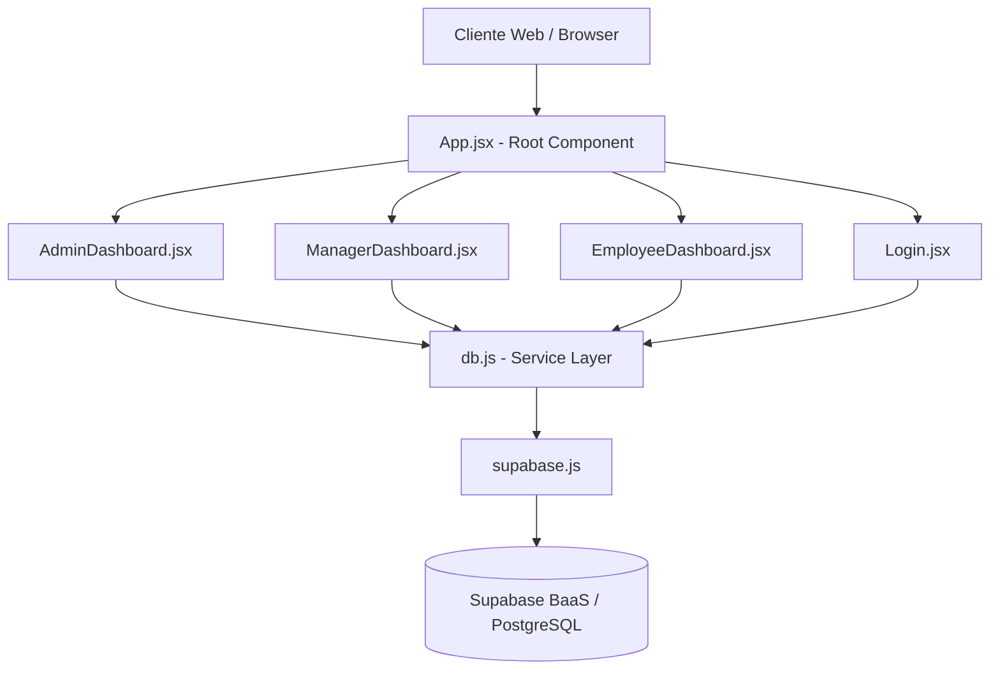

# Arquitetura Geral

## O que é
A Arquitetura Geral detalha como o sistema é desenhado de alto nível, desde a camada visual até o armazenamento de dados.

## Para que serve
Para entender as dependências e o padrão arquitetural escolhido (SPA + BaaS).

## Onde está
Não é um arquivo físico, é a composição de toda a pasta `src/` e do ambiente cloud do Supabase.

## Como funciona
O sistema é um Single Page Application (SPA) renderizado via Vite e React. O roteamento (navegação) é simulado utilizando variáveis de estado no arquivo [[App]] (`currentTab`), em vez de uma biblioteca de rotas oficial como React Router.
A aplicação conversa diretamente com a nuvem utilizando o cliente do Supabase (`supabase-js`), pulando uma camada de backend tradicional em Node.js.

## Do que depende
- Node.js (ambiente de build e dev)
- Vite (Empacotador)
- React e ReactDOM
- Supabase (Backend)

## Quem depende dele
Todos os módulos da aplicação.

## O que pode quebrar se for alterado
Mudar a dependência do Supabase para um backend próprio exigiria reescrever toda a camada do [[db]] e o gerenciamento de autenticação. Adicionar uma biblioteca de rotas (como `react-router-dom`) exigiria refatorar a troca de abas no [[App]] e na [[Sidebar]].
